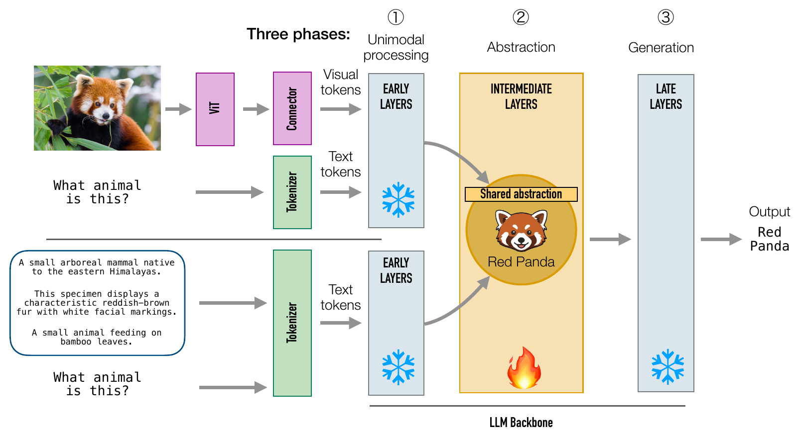

# Visual Instruction Tuning Aligns Modalities through Abstraction

[](https://arxiv.org/abs/2606.03871)
[](https://luisfpal.github.io/multimodal_finetuned_representations/)
[](https://huggingface.co/lbasile)
[](https://huggingface.co/l11p)
[](LICENSE)

**Luis Palacios\*, Lorenzo Basile\*, Diego Doimo†, Alberto Cazzaniga†**  
Area Science Park, Trieste, Italy · \* Equal contribution. † Equal supervision.

[**Paper**](https://arxiv.org/abs/2606.03871) · [**Project page**](https://luisfpal.github.io/multimodal_finetuned_representations/) · [**Models & data**](#models-and-data) · [**Citation**](#citation)

<p align="center"></p>

## TL;DR

Across several vision-language architectures, visual instruction tuning mainly acts as a
bridge: it embeds visual features directly into the **intermediate semantic layers** of the
LLM backbone, bypassing the early layers devoted to unimodal processing. Probing and causal
interventions show these layers are the semantic core of vision-language processing;
fine-tuning extends and strengthens the existing abstraction phase, aligning visual features
with pre-existing textual ones. Restricting fine-tuning to the intermediate layers preserves
the performance of full fine-tuning on vision-centric benchmarks while reducing training time.

## Contents

- [Quick start](#quick-start)
- [Reproducing the paper](#reproducing-the-paper)
- [Models and data](#models-and-data)
- [Repository structure](#repository-structure)
- [Citation](#citation)
- [License](#license)

## Quick start

Requires an NVIDIA GPU with CUDA 12 (open **Full installation** below if `uv sync` fails).

```bash
git clone https://github.com/luisfpal/multimodal_finetuned_representations.git
cd multimodal_finetuned_representations
uv sync && source .venv/bin/activate
cp .env.example .env          # set PYTHONPATH to this folder and your Hugging Face cache paths
set -a && source .env && set +a

# Smoke test: evaluate LLaVA-1.5-7B on 50 POPE samples with lmms-eval
python scripts/eval/lmms_evaluation.py \
    --model-name-or-path lbasile/llava_7b \
    --model-cache-dir "$HF_HUB_CACHE" \
    --output-dir evals/llava_7b/lmms_eval/pope \
    --task-name pope \
    --batch-size 1 \
    --limit 50
```

Results are written under `evals/llava_7b/lmms_eval/pope/`. A `ModuleNotFoundError` for `utils` or `scripts` means `PYTHONPATH` in `.env` does not point to this folder. To run the paper's experiments,
see [Reproducing the paper](#reproducing-the-paper); each launcher has its configuration at the top.

<details>
<summary><b>Full installation (requirements, environment file, CUDA and flash-attention)</b></summary>

> **Note.** The setup below is the one we used on our cluster (SLURM, NVIDIA A100 and H100
> nodes, CUDA 12). Paths, SLURM settings and CUDA locations are specific to that environment;
> adapt them to yours.

### Requirements

- Python 3.12
- An NVIDIA GPU driver compatible with CUDA 12 wheels
- A CUDA toolkit on `PATH` (`nvcc --version` must work; see **CUDA and flash-attention troubleshooting** below)
- [`uv`](https://github.com/astral-sh/uv) for dependency management

The dependency stack is pinned in `pyproject.toml` / `uv.lock`, notably `torch==2.9.0` and
`torchvision==0.24.0` from the CUDA 12.6 PyTorch wheel index, and `flash-attn==2.8.3` from a
pinned prebuilt wheel for torch 2.9, CUDA 12 and Python 3.12.

### Environment file

```bash
cp .env.example .env
```

Edit `.env` for your machine:

- `PYTHONPATH`: absolute path to this repository
- `HF_HOME`, `HF_HUB_CACHE`, `HF_DATASETS_CACHE`: Hugging Face caches

LLM-judged benchmarks (MMBench, MM-Vet, LLaVA-in-the-Wild in lmms-eval) need an
OpenAI-compatible endpoint. Set `OPENAI_API_KEY`, `OPENAI_API_URL` and `MODEL_VERSION`
directly (`ensure_llm_judge_env()` in `utils/llm_judge.py` returns early once `OPENAI_API_KEY` is
set); the `ORFEO_*` entries in `.env.example` are our cluster's optional way of obtaining
them and can be left unset, or adapt `_acquire_orfeo_jwt()` to your own auth provider. All other experiments run without an LLM judge.

Never commit a real `.env`. Keep large model, dataset, representation and evaluation caches outside the repository.

### Install

```bash
uv sync
source .venv/bin/activate
python -c "import torch, flash_attn; print(torch.__version__)"
```

Always install from the lockfile with `uv sync`; do not install project dependencies with raw `pip`.

If lmms-eval crashes on an unresolved task `include:` (the lmms-eval wheel omits some extension-less template files), run `python scripts/setup/patch_lmms_eval.py` once after `uv sync`.

</details>

<details>
<summary><b>CUDA and flash-attention troubleshooting</b></summary>

`flash-attn` is a compiled CUDA extension: `uv sync` needs a working `nvcc` on `PATH`, and the
extension is built for a specific GPU compute capability. Most install failures on a new
machine come from one of the cases below.

**Case 1: a system CUDA toolkit exists but is not on `PATH`** (common on shared clusters,
e.g. `/usr/local/cuda-12.2`). Add it yourself, e.g. in `~/.bashrc`:

```bash
export CUDA_HOME=/usr/local/cuda-12.2   # match the version actually installed
export PATH="$CUDA_HOME/bin:$PATH"
export LD_LIBRARY_PATH="$CUDA_HOME/lib64:${LD_LIBRARY_PATH:-}"
```

There is no portable way to discover "the" system CUDA path, so this is a one-time change on your machine.

**Case 2: no root access and no system toolkit.** `scripts/setup/install_local_cuda.sh`
downloads the NVIDIA CUDA runfile, installs a toolkit under
`~/.local/cuda-<major.minor>` (for example `cuda-12.2`) without `sudo`, and adds it to `~/.bashrc` between managed markers.

```bash
bash scripts/setup/install_local_cuda.sh
source ~/.bashrc
uv sync && source .venv/bin/activate

# Options: non-default location / architecture
bash scripts/setup/install_local_cuda.sh --help
bash scripts/setup/install_local_cuda.sh --install-dir "$HOME/scratch/cuda-12.2" --arch-list "8.0"

# Non-default CUDA versions need the exact NVIDIA runfile URL
bash scripts/setup/install_local_cuda.sh --cuda-version 12.6.0 --runfile-url "<NVIDIA CUDA runfile URL>"
```

**`TORCH_CUDA_ARCH_LIST` must match the GPU you build on.** It is not auto-detected in every
code path, and a value copied from another machine silently builds for the wrong architecture.

| GPU  | Compute capability | `TORCH_CUDA_ARCH_LIST` |
| ---- | ------------------ | ---------------------- |
| A100 | 8.0                | `"8.0"`                |
| H100 | 9.0                | `"9.0"`                |

`install_local_cuda.sh --arch-list` defaults to `"8.0"` (A100). On an H100 pass
`--arch-list "9.0"`, or export `TORCH_CUDA_ARCH_LIST="9.0"` before `uv sync` in Case 1. We
ran on both A100 and H100 nodes; the value must match the node where the environment is built.

**If you change torch, CUDA or Python**, the pinned flash-attn wheel URL in
`[tool.uv.sources]` of `pyproject.toml` will 404. Use the matching wheel from the
[flash-attention releases](https://github.com/Dao-AILab/flash-attention/releases) or build from source.

**Checklist if installation fails:**
1. `python --version` reports 3.12.
2. `nvcc --version` works in the shell where you run `uv sync`.
3. `TORCH_CUDA_ARCH_LIST` matches the GPU.
4. `.env` points `PYTHONPATH` and the Hugging Face caches to valid paths.
5. `pyproject.toml` still contains the pinned `flash-attn` wheel source.

</details>

## Reproducing the paper

The pipeline is: (1) extract residual-stream representations of each model on the datasets
with the prompt formats we designed, (2) analyse them (similarity, probing, retrieval, causal
ablations, benchmark evaluation), and (3) plot. Open a launcher and review its configuration
block (models, datasets, SLURM resources, output directories) before submitting it with `bash <launcher>`.
Local (non-SLURM) scripts run directly, e.g. `bash shell/eval/run_local_evaluation.sh "lbasile/llava_7b"` (first set `PROJECT_ROOT` near the top of that script to your clone).

| Paper | Experiment | Launcher | Plot script |
| ----- | ---------- | -------- | ----------- |
| Fig. 2, 6, 8-11 | Multimodal layer skipping / cross-modal attention knockout | `shell/eval/launch_layer_ablation_multimodal.sh` | `plotting/diego/ablations_mm_tueplots.py` |
| Fig. 33 | Information-imbalance plane, Llama-3.2-90B-Vision-Instruct | `shell/representations_interpretability/llama_vision_similarity.sh` (via `launch_job.sh`) | `plotting/plot_llama_imbalance_paper.py` (writes `information_imbalance_<tag>.pdf`, renamed `llama_information_imbalance.pdf` in the paper) |
| Fig. 34 | Visual reliance vs. localized fine-tuning gains (Llama-3.2-90B) | `shell/eval/launch_layer_ablation_multimodal.sh` (`Meta-Llama-3-90B-instruct`, `cross_modal`) | `plotting/diego/plot_localized_cross_modal_90b.py` (writes to `./results/plots/`) |
| Fig. 7, 12, 13 | Text-only layer skipping | `shell/eval/launch_layer_ablation_text.sh` | `plotting/diego/ablations_text_tueplots.py` |
| Fig. 3 | Label overlap and logit lens | `shell/representations_interpretability/representations_classification.sh`, `shell/eval/launch_logitlens.sh` | `plotting/logitlens_overlap_two_panel_tueplots.py` |
| Fig. 14, 15 | Label overlap across depth / datasets | `shell/representations_interpretability/representations_classification.sh` | `plotting/luis/label_overlap_tueplots.py` |
| Fig. 16-18 | Logit lens and linear probe on VQA | `shell/eval/launch_logitlens.sh` | `plotting/logitlens_plots_tueplots.py` |
| Fig. 4, 21-23 | Information imbalance | `shell/embeddings_extraction/launch_information_imbalance.sh` | `plotting/luis/imbalance_paper_tueplots.py` |
| Fig. 24-29 | Linear CKA and neighborhood overlap | `shell/representations_interpretability/multimodality_similarity.sh` (via `launch_job.sh`) | `plotting/luis/heatmap_similarities_tueplots.py` |
| Fig. 19 | COCO image-caption retrieval | `shell/retrieval/launch_retrieval.sh` | `plotting/diego/plot_retrieval_metrics_tueplots.py` |
| Fig. 20 | SentEval linguistic probing | `shell/probing/launch_probing.sh` | `plotting/diego/plot_probing_tasks_tueplots.py` |
| Appendix table "Multimodal task performance" | Benchmark scores of all models | `shell/eval/launch_lmms.sh` | `plotting/table2.py` (prints the LaTeX table) |
| Fig. 5, 30, 31 | Benchmark evaluation of localized fine-tuning (Fig. 5: gain vs. image reliance) | `shell/eval/launch_lmms.sh` (benchmark set by `TASK_NAME` in `shell/eval/lmms_evaluation.sh`), `shell/eval/run_local_evaluation.sh`; MMMU: `shell/eval/run_mmmu_evaluation.sh` | `plotting/all_benchmarks_plots_tueplots.py` |

Notes on the table:

- Scripts in `shell/representations_interpretability/` without `#SBATCH` lines are workers: set
  `SCRIPT_NAME=<file>` in `shell/representations_interpretability/launch_job.sh`, then run
  `bash shell/representations_interpretability/launch_job.sh`. The committed `SCRIPT_NAME` is live
  (currently `llama_vision_representations_classification.sh`, 6 GPUs), so check it before submitting.
- Metrics as computed in the code: `plotting/table2.py` (Tables 5-6) reports POPE as `pope_f1_score` and MME as
  (`mme_perception_score` + `mme_cognition_score`) / 2800; `plotting/all_benchmarks_plots_tueplots.py` (Figs. 5, 30, 31)
  uses `pope_accuracy` and the same MME total; the layer-ablation plots and Fig. 34 use `mme_perception_score` only.
- Fig. 1 is a schematic and has no script. The Llama-3.2-90B cross-modal ablation in Fig. 32 has no plot script in this release.
- `plotting/all_benchmarks_plots_tueplots.py` uses `adjustText` for label placement if installed
  (optional; add it with `uv add adjustText`); without it, labels are placed without adjustment.

Other entry points used for the paper's representations and benchmarks:

- Captioning pipeline that builds the captioned evaluation sets (`l11p/*-captioned`):
  `shell/captioning/launch_captioning.sh` → `scripts/captioning/caption_dataset.py` → `src/captioner.py`
  (OpenAI-compatible endpoint, see the environment file section); captioned benchmarks are evaluated with
  `shell/eval/launch_lmms_captioned.sh` / `shell/eval/run_local_captioned_evaluation.sh`

- Multi-model representation extraction: `shell/embeddings_extraction/launch_extract_embeddings.sh`
- Llama-3.2-Vision (`Meta-Llama-3-90B-instruct`) representation classification: `shell/representations_interpretability/llama_vision_representations_classification.sh`
- COCO-QA evaluation (image / human-caption / synthetic-caption inputs): `shell/eval/run_local_cocoqa_evaluation.sh`
- Compositionality (ARO, SugarCrepe): `shell/eval/launch_compositionality.sh`

Pre-trained reference checkpoints were built once with
`scripts/models_utils/create_pretrained_models.py` (LLaVA-1.5) and
`scripts/build_cambrian_pretrained.py` / `scripts/download_cambrian_projector.py` (Cambrian);
`scripts/compare_model_weights.py` diffs two checkpoints as a sanity check.

<details>
<summary><b>Where outputs are written (paths and environment variables)</b></summary>

All paths are set at the top of each launcher (and in `.env`); change them there to fit your machine.

| What | Default location | How to change |
| ---- | ---------------- | ------------- |
| Repository root used by launchers | `PROJECT_ROOT` / `PROJECT_DIR`, mostly `$HOME/multimodal_finetuned_representations` | Edit the variable at the top of the launcher |
| Cached representations | `REPRESENTATIONS_DIR`; the default differs per launcher (`$HOME/scratch` in most, `$HOME/scratch/representations` or `$HOME/scratch/pooling_tests` in others) and some Python scripts default to `~/scratch/representations` | Export `REPRESENTATIONS_DIR` once so all experiments share one cache root |
| Experiment results | `$PROJECT_ROOT/results/` | `RESULTS_DIR` / `--results-dir` in the launcher |
| Benchmark evaluations | `$PROJECT_ROOT/evals/<model>/...` | `OUTPUT_DIR` in the eval launcher |
| SLURM logs | `$PROJECT_ROOT/logs/` | `LOG_DIR` / `#SBATCH --output` |
| Paper figures | `plotting/tueplots/` (via `plotting/_tueplots_style.py`; created at runtime) | `OUTPUT_DIR` in `_tueplots_style.py` |
| Model / dataset caches | `HF_HOME`, `HF_HUB_CACHE`, `HF_DATASETS_CACHE` | `.env` |
| lmms-eval cache | `LMMS_EVAL_HOME=$HOME/scratch/lmms_eval_cache` | Eval launchers |

</details>

<details>
<summary><b>Cluster-specific notes (SLURM, absolute paths)</b></summary>

**Our cluster setup, to adapt.** The launchers are kept exactly as we ran them, so they contain
paths, SLURM accounts and partitions from our cluster. Before running a launcher on your machine,
edit its configuration block. In particular, some `shell/eval/` scripts (`launch_logitlens.sh`, `run_local_logitlens.sh`,
`run_local_evaluation.sh`, `run_local_compositionality_evaluation.sh`, `launch_lor.sh`) set
`PROJECT_ROOT` to an absolute path on our cluster; set it to your clone before running them.
SLURM launchers also set our `--account`, `--partition` and GPU type; replace them with yours.

</details>

## Models and data

Pre-trained (before visual instruction tuning) and instruction-tuned checkpoints studied in the paper:

| Family | Pre-trained / base | Instruction-tuned |
| ------ | ------------------ | ----------------- |
| LLaVA-1.5 (7B, 13B) | `l11p/llava-v1.5-{7b,13b}-pretrained-lbasile` (built from `liuhaotian/llava-v1.5-mlp2x-336px-pretrain-vicuna-{7b,13b}-v1.5` + `lmsys/vicuna-{7b,13b}-v1.5`) | `llava-hf/llava-1.5-{7b,13b}-hf`; `lbasile/llava_7b`, `lbasile/llava_13b` |
| LLaVA-OneVision-1.5 (4B, 8B) | `lmms-lab/LLaVA-OneVision-1.5-{4B,8B}-Base` | `lmms-lab/LLaVA-OneVision-1.5-{4B,8B}-Instruct` |
| InternVL2 (8B) | `OpenGVLab/InternVL2-Pretrain-Models/InternVL2-8B-Pretrain` | `OpenGVLab/InternVL2-8B` |
| Cambrian-1 (8B) | `nyu-visionx/cambrian-8b-pretrain` (assembled as `lbasile/cambrian-8b-pretrained`) | `nyu-visionx/cambrian-8b` |
| Llama-3.2-Vision (90B) | – | `meta-llama/Llama-3.2-90B-Vision-Instruct` (referred to by the local ID `Meta-Llama-3-90B-instruct` in our launchers) |

**Our Hugging Face repositories.** The accounts [`lbasile`](https://huggingface.co/lbasile) and [`l11p`](https://huggingface.co/l11p) host the model checkpoints and datasets we created for the paper's results, for example the LLaVA-1.5
localized fine-tuning variants (`lbasile/llava_7b_<start>_<end>`, e.g. `lbasile/llava_7b_6_16`,
`lbasile/llava_7b_0_16`, `lbasile/llava_7b_16_32`), the pre-trained LLaVA references
(`l11p/llava-v1.5-*-pretrained-lbasile`), and captioned evaluation sets
(`l11p/COCOQA-restval-ICQA`, `l11p/VQAv2-COCO-restval-ICQ`, `l11p/*-captioned`).
The scripts that build them are in `scripts/models_utils/` and `scripts/create_datasets/`.

<details>
<summary><b>Benchmark data</b></summary>

Benchmarks are loaded from the Hugging Face Hub (through `datasets` / lmms-eval /
lm-eval-harness) into the caches set in `.env`. See Appendix B of the paper for the full list.
A few datasets are downloaded to disk by helper scripts:

- ARO images: `shell/data/download_aro_images.sh` (default root `$HOME/scratch/datasets/vision-language-models-are-bows`)
- SugarCrepe: `shell/data/download_sugarcrepe.sh` (`SUGARCREPE_DATA_ROOT`, default `$HOME/scratch/datasets/sugar-crepe`)

</details>

## Repository structure

```text
scripts/        Python entry points (eval/, representations_interpretability/, embeddings_extraction/,
                retrieval/, probing/, models_utils/, create_datasets/, captioning/, setup/, data/)
shell/          SLURM and local launchers, mirroring scripts/
src/            Residual-stream tracer and captioner
utils/          Model loading, datasets, metrics, layer-skipping patches (vlm_layer_skipping/)
                Two layer-skipping families, both used for the paper:
                - utils/vlm_layer_skipping/: layer skipping and cross-modal attention knockout,
                  used for the layer-ablation figures, linguistic probing and representation
                  extraction; patch_llama_vision.py covers Llama-3.2-Vision cross-attention
                - utils/patch_{llava,onevision,internvl,cambrian}.py: removes image tokens in all
                  layers for the text-only runs of scripts/eval/lmms_evaluation.py and
                  compositionality_evaluation.py (image-reliance baselines)
                - utils/patch_skipping.py: earlier LLaVA-only patch used by
                  scripts/eval/ablation_layers_evaluation.py (not used for the paper figures)
tasks/          Custom lmms-eval task configs (captioned variants)
plotting/       Paper figure scripts
third_party/    Vendored Cambrian and ARO ("vision-language-models-are-bows") code
*_demo.ipynb    Demos for LLaVA, LLaVA-OneVision, InternVL2 and Cambrian
```

## Citation

```bibtex
@article{palacios2026visual,
  title   = {Visual Instruction Tuning Aligns Modalities through Abstraction},
  author  = {Palacios, Luis and Basile, Lorenzo and Doimo, Diego and Cazzaniga, Alberto},
  journal = {arXiv preprint arXiv:2606.03871},
  year    = {2026}
}
```

The project page lives in `docs/` (static HTML, no build step). GitHub Pages deploys it from branch `main`, folder `/docs` (**Settings > Pages > Deploy from a branch**), at <https://luisfpal.github.io/multimodal_finetuned_representations/>.

## License

Released under the [MIT License](LICENSE). Code in `third_party/` keeps its original license.
